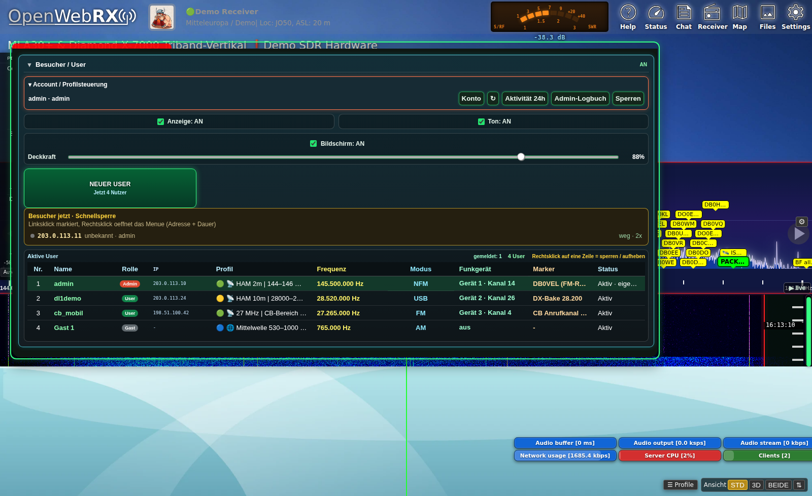
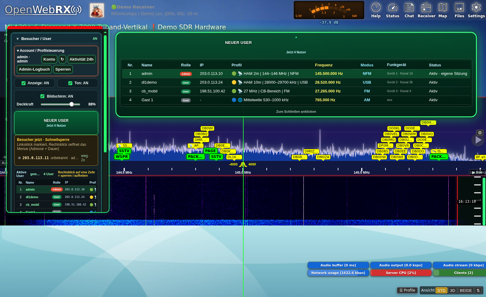
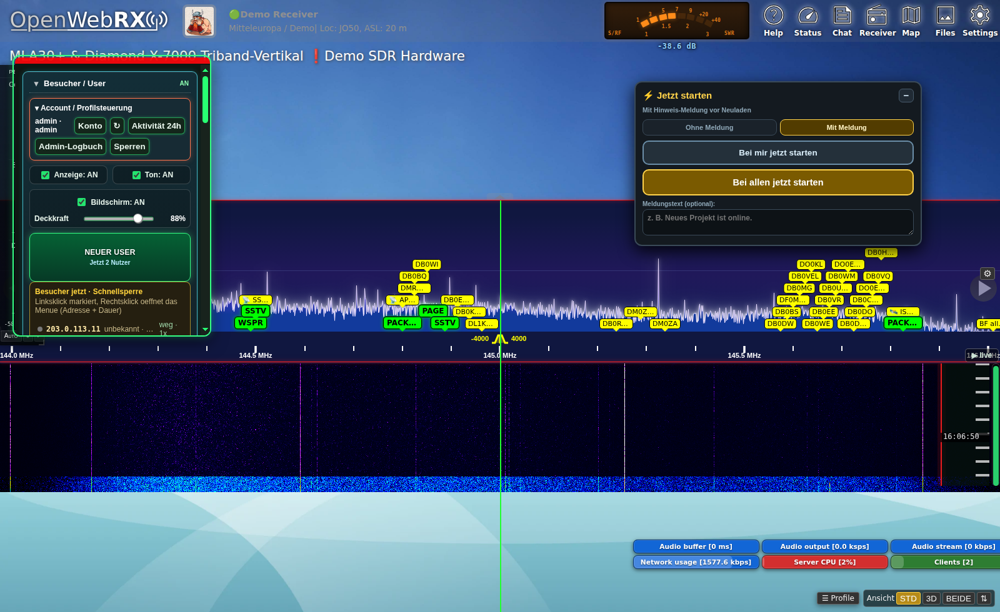
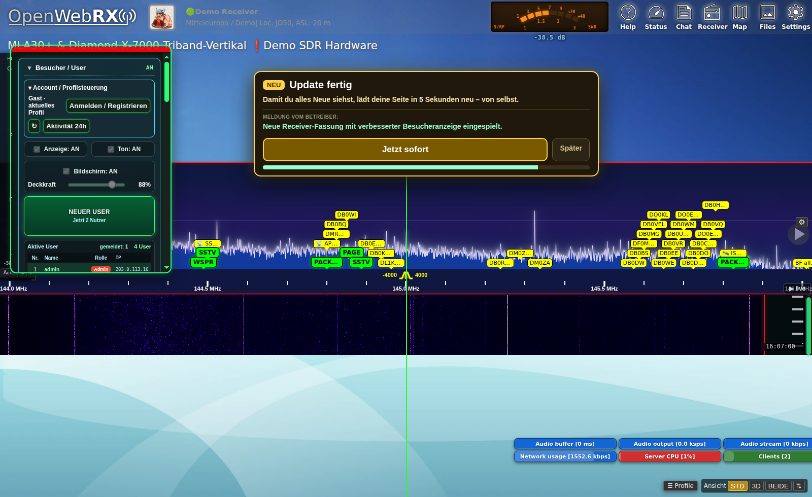
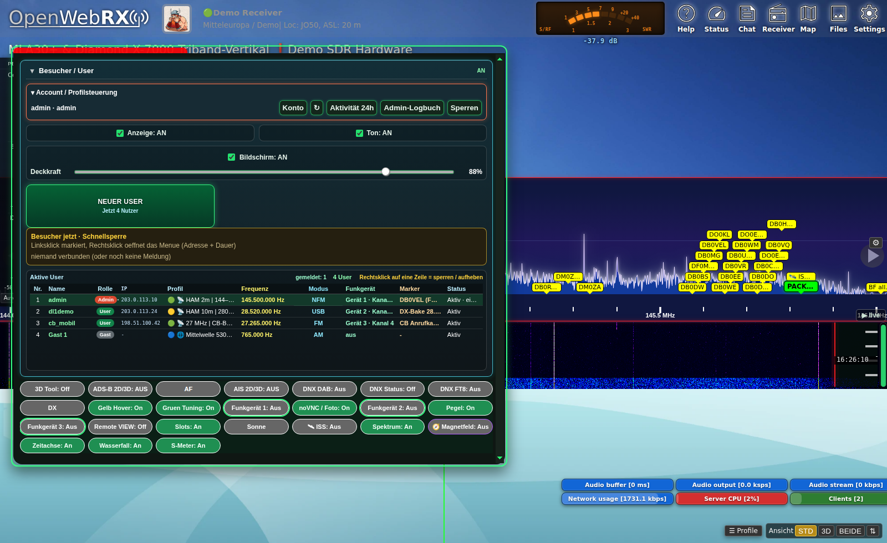

# DNX OWRX Besuchertool (`v1.3.3`)

<!-- DNX-DISCLAIMER-START -->
> **Wichtiger Hinweis / Vollständige Distanzierung (Hobby-Mod-Mode)**
>
> - **Vollständige Distanzierung:** Ich distanziere mich in jeder Hinsicht vollständig vom Projekt **OpenWebRX / OpenWebRX+** sowie dessen Entwicklern und Betreibern. Es besteht keinerlei Verbindung, Zusammenarbeit, Prüfung, Befürwortung oder Partnerschaft.
> - **Keine öffentlichen/offiziellen OpenWebRX-Plugins (nur Mod-Mode):** Bei diesem Projekt handelt es sich ausdrücklich **nicht** um ein öffentliches oder offizielles Plugin von OpenWebRX, sondern ausschließlich um einen privaten, inoffiziellen **Mod-Mode** (Eigenmodifikation).
> - **Warum bewusst kein reines Browser-JavaScript (Mod-Mode-Architektur):** Viele Funktionen (z. B. serverseitige Speicherung, Konten-/Rollenverwaltung, Profil-Synchronisation, VNC-/websockify-Brücken, geschützte Schnittstellen, Docker-/Systemintegration und stabile UI-Anpassungen) lassen sich sauber und sicher nicht allein über simples Client-JavaScript umsetzen, ohne den OpenWebRX-Kern umzubauen oder Browsergrenzen zu umgehen. Deshalb setzt dieses Projekt bewusst auf getrennte Begleitmodule, Shell-Installer und Dienste im **Mod-Mode** statt alles künstlich in reines JavaScript zu pressen.
> - **Kein öffentlicher Support & keine Haftung:** Es gibt **keinen öffentlichen Support**, keine Garantie und keine Haftung. Nutzung, Installation und Anpassung erfolgen vollständig auf eigene Gefahr (immer vorher Backups anlegen und zunächst im eigenen Testsystem prüfen).
> - **Reines Hobbyprojekt – frei nutzbar, änderbar & verbreitbar:** Dieses Projekt entsteht ausschließlich aus reinem Hobby und Interesse am gemeinsamen Funk-/SDR-Hobby. Es steht ausdrücklich frei zur Verfügung und darf frei genutzt, weiterverbreitet, verändert und verbessert werden.
<!-- DNX-DISCLAIMER-END -->

> **Important Notice / Full Disassociation (Hobby Mod-Mode Only)**
>
> - **Full Disassociation:** I completely disassociate myself from **OpenWebRX / OpenWebRX+** and its developers/maintainers. There is no affiliation, endorsement, review, or partnership of any kind.
> - **No Official/Public OpenWebRX Plugins (Mod-Mode Only):** These files are **not** official or public OpenWebRX plugins, but purely unofficial hobby modifications (*mod-mode*).
> - **No Public Support & No Warranty:** There is **no public support**, no warranty, and no liability. Use entirely at your own risk.

<!-- DNX-PREVIEW-START -->
## Live-Vorschau & Galerie (`DNX OWRX Besuchertool`)

| Ansicht | Beschreibung | Screenshot |
|---|---|---|
| **Besucherliste & Empfänger-Panel** | Komplette 10-Spalten-Tabelle (`Nr.`, `Name`, `Rolle`, `IP`, `Profil`, `Frequenz`, `Modus`, `Funkgerät`, `Marker`, `Status`), eigene Sitzung hervorgehoben, `Account / Profilsteuerung` & 3-Geräte-Schalterleiste |  |
| **Vollbild-Besucher-Overlay** | Zuschaltbare große Bildschirmansicht (`Bildschirm: AN`, stufenloser Deckkraftregler) direkt über dem Wasserfall |  |
| **Update-Wache (`Admin-Panel`)** | Streng serverseitig geschütztes Admin-Bedienfeld (`⚡ Jetzt starten`) mit optionaler Betreibermeldung und Sofort-/Countdown-Auslösung für verbundene Besucher |  |
| **Update-Wache (`Besucherkarte`)** | Mehrsprachige Besucher-Benachrichtigungskarte mit Betreiberhinweis und eigenem Countdown ohne Admin-Steuerlemente für Gäste |  |
| **3-Geräte-Schalterleiste (`v6.10`)** | Aktive Anzeige von `Gerät 1 · Kanal 14`, `Gerät 2 · Kanal 26` & `Gerät 3 · Kanal 4` in der Spalte `Funkgerät` samt Umschaltleiste `Funkgerät 1 / 2 / 3` |  |
<!-- DNX-PREVIEW-END -->

Live-Besucheranzeige mit optionaler Accountname-/Rollen-Verknüpfung (`dnx-access-control`), `Marker`- & `Funkgerät`-Spalte (`v6.11`), serverseitiger Eigenzeilen-Erkennung (`eigene`) sowie der gehärteten **DNX Update-Wache `v3.12`**.

## Funktionsumfang

- **10-Spalten-Besucherübersicht im Receiver-Panel:** Zeigt pro WebSocket-Verbindung `Nr.`, `Name`, `Rolle`, `IP` (serverseitig strikt nur für Admins über `visitorstatus.py`), `Profil`, `Frequenz`, `Modus`, aktives `Funkgerät` (inkl. Gerät `1` / `2` / `3` und Kanal), `Marker` sowie `Status` – jede Sitzung bleibt als eigene Zeile sichtbar.
- **Serverseitige Eigenzeilen-Erkennung (`eigene`):** `visitorstatus.py` liefert das Feld `eigene` samt `dnx-kennung`-Cookie-Header-Fallback und `getattr(c, "dsp", None)` (lock-freies Auslesen ohne WebSocket-Deadlocks).
- **Vollbild-Overlay & Schnell-Steuerung:** Zuschaltbare Großansicht (`Bildschirm: AN`) mit Deckkraftregler (`%`), `Anzeige: AN/AUS`, `Ton: AN/AUS`, `Account / Profilsteuerung` (`Konto`, `Aktivität 24h`, `Admin-Logbuch`, `Sperren`) sowie Admin-Schnellsperre per Klick auf eine Besucherzeile.
- **3-Geräte-Unterstützung (`dnx_styler.js v6.11`):** Anzeige und Synchronisierung für `Funkgerät 1 / 2 / 3` (`1 ⇄ 2 ⇄ 3`-Mausradtausch) über `:8099`.
- **Gehärtete Update-Wache (`dnx_update_wache.js v3.12`):**
  - Streng servergeprüfte Admin-Freigabe über `api/me` (`:8095 / :8096 / :8091`); lokale Altlasten (`?updateadmin=1`, `dnx.update.kasten.wer`, `dnx_betreiber`) werden aktiv entfernt – Gäste und normale User erhalten niemals das Admin-Panel.
  - Automatische Re-Prüfung bei Fokus-/Seitenwechsel sowie mehrsprachige Update-Karten (9 Sprachen) und dreifache Endlosschleifen-Sperre (`localStorage`, `sessionStorage`, `?v=<ts>`).

## Neu in v1.3.3

- **`dnx_styler.js` (`v6.11` / UI `v6.28`) + `dnx_stand.txt` (`v6.11 1018999`):** Mitgelieferte Styler-/Besucher-Komplettfassung auf Stand `v6.11` synchronisiert (inkl. Spektrum-/Wasserfall-Entkopplung nach SDR#-Art mit `DNX-Pegel`, kalibriertem dBFS-Spektrum-Raster `#dnx-spek-raster`, `Spektrum-Skala` & `3-Geräte-Schalterleiste`).
- **`v1.3.2`–Basis beibehalten:** Gehärtete **Update-Wache `v3.12`**, lock-freies `visitorstatus.py` (`getattr(c, "dsp", None)` + `dnx-kennung`-Cookie-Fallback + IP-Schutz) sowie `index.html` (`?v=20261121b`).

## Dateien im Paket (`besuchertool/`)

| Datei | Ziel | Zweck |
|---|---|---|
| `visitorstatus.py` | `/usr/lib/python3/dist-packages/owrx/controllers/visitorstatus.py` (im Container/System) | Besucherliste + Feld `eigene` + Cookie-Fallback + IP-Schutz |
| `dnx_update_wache.js` | `…/htdocs/plugins/receiver/dnx_update_wache.js` | Update-Wache `v3.12` (servergeprüfter Admin-Zugriff) |
| `dnx_styler.js` | `…/htdocs/plugins/receiver/dnx_styler.js` | Besucherliste, Kennungswort & 3-Geräte-Leiste (`v6.11`, `1.018.999 B`) |
| `dnx_stand.txt` | `…/htdocs/plugins/receiver/dnx_stand.txt` | Versions-/Größenstempel (`v6.11 1018999`) |
| `index.html` | `…/htdocs/index.html` (Vorlage) | Lädt `dnx_update_wache.js?v=20261121b` |
| `docs/` | — | 5 sachliche `1600×980`-Funktionsscreenshots |

**Wichtig:** Nach Austausch von `visitorstatus.py` den OpenWebRX-Container bzw. Dienst einmal neu starten (`docker restart <container>`). Vorher immer Backups anlegen (`cp <ziel> <ziel>.bak-<datum>`).

## Voraussetzungen

- Kompatible OpenWebRX-/OpenWebRX+-Installation
- Zustandsdienst auf Port `8099` (`DNX Remote VIEW`) für die Funkgerät-Spalte und Update-Flags
- `DNX Receiver Account Control` (`api/me`) für Konten-/Rollenerkennung im Update-Panel

## Rechtlicher Hinweis / Disclaimer

**DE:** Private, inoffizielle Hobby-Anpassung (Mod-Mode) für OpenWebRX / OpenWebRX+. Kein offizielles OpenWebRX- oder OpenWebRX+-Projekt, keine Verbindung zu oder Unterstützung durch die jeweiligen Entwickler. Nutzung erfolgt vollständig auf eigene Gefahr; soweit gesetzlich zulässig wird jede Haftung ausgeschlossen. Vor dem Einspielen bitte Sicherungen anlegen.

**EN:** Private, unofficial hobby modification (Mod-Mode) for OpenWebRX / OpenWebRX+. Not an official OpenWebRX or OpenWebRX+ project; no affiliation with or support from its maintainers. Use entirely at your own risk; to the extent permitted by law, no liability is accepted. Always create backups before installing.
